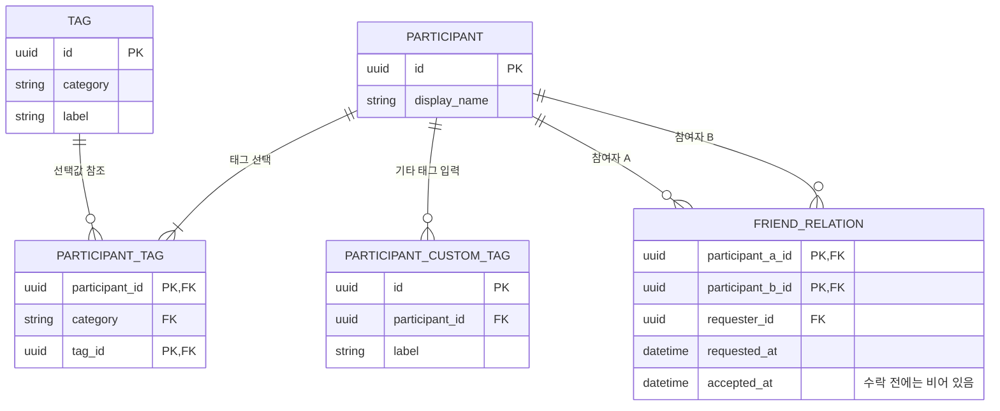

# 허들링클럽 밋업 네트워킹 ERD

[PRD §4–5](PRD.md#4-입력과-서버-처리-기준)의 단일 밋업을 기준으로 작성한 논리 모델이다. 마이페이지는 온보딩과 같은 입력 구조를 사용한다. 표시 이름과 기수는 필수이며 기수는 제공된 선택지에서 정확히 한 값을 고른다. 직무·조·근무 지역은 항목별로 제공된 선택지에서 0개 이상 고른다. 기타는 선택 사항이며, 자유 입력 태그를 여러 개 추가하거나 개별 삭제할 수 있다.

## 엔터티와 관계

| 엔터티 | 저장 내용과 제약 |
|---|---|
| `PARTICIPANT` | 세션과 QR 프로필 링크가 참조하는 참여자. 표시 이름은 필수이며 앞뒤 공백을 제거한 뒤 빈 값은 거절한다. 동명이인을 허용한다. |
| `TAG` | 기수·직무·조·근무 지역의 선택값. `(category, label)`을 고유하게 유지하고, 복합 외래 키가 참조할 `(id, category)`에도 고유 제약을 둔다. |
| `PARTICIPANT_TAG` | 기본 키 `(participant_id, tag_id)`로 같은 선택값의 중복 저장을 막는다. 복합 외래 키 `(tag_id, category)`는 `TAG(id, category)`를 참조한다. 기수 행에만 참여자별 고유 제약을 적용해 최대 한 값을 보장한다. 직무·조·근무 지역은 각각 여러 값을 저장할 수 있다. |
| `PARTICIPANT_CUSTOM_TAG` | 참여자가 작성한 기타 태그 한 개를 행 하나로 저장한다. 입력값의 앞뒤 공백을 제거하고 빈 문자열은 거절한다. 동일 참여자의 동일 문구에 `(participant_id, label)` 고유 제약을 두고, 삭제는 소유자의 세션과 태그 ID로 대상을 지정한다. |
| `FRIEND_RELATION` | 두 참여자 ID를 같은 순서로 정렬해 복합 기본 키로 저장한다. `participant_a_id < participant_b_id`와 요청자가 두 참여자 중 한 명이라는 조건을 둔다. 요청 시각은 필수이며, 수락 시각은 수락 이후에 채운다. |

서버는 등록과 수정의 최종 상태에 표시 이름과 기수 한 값이 있는지 검증하고, 이름과 태그 변경을 한 트랜잭션으로 처리한다.

**공통점 계산**은 선택형 태그 ID의 교집합과 기타 태그 문구의 교집합을 합친다. 같은 항목에서 두 값이 겹치면 공통점 두 개로 센다. 기타는 앞뒤 공백을 제거한 뒤 문구를 정확히 비교한다. 선택형은 선택형끼리, 기타는 기타끼리 비교한다. 공통 기타 태그만 있어도 추천 대상이며, 홈의 태그별 그룹과 전체 그룹 목록은 선택형 태그로 집계한다.

## 화면에서 사용하는 데이터

| 화면 | 조회·저장 규칙 |
|---|---|
| 온보딩 · 마이페이지 | 이름과 기수만 필수다. 기수를 바꿀 때는 기존 값을 교체한다. 직무·조·근무 지역은 값별로 선택·해제할 수 있고, 기타는 값별로 추가·삭제할 수 있다. 선택 항목을 모두 비운 상태로도 저장할 수 있다. |
| 홈 · 그룹 리스트 · 그룹 상세 | 선택형 태그 ID로 그룹을 식별하고 현재 선택한 참여자를 집계한다. 내 태그별 홈에서는 같은 사람이 여러 그룹에 나타날 수 있다. 구성원이 0명이면 전체 그룹 목록에서 제외한다. |
| 친구추천 | 본인과 기존 친구를 제외한다. 선택형 또는 기타 공통점이 하나 이상인 상대를 참여자 ID로 묶어 한 명당 한 건을 반환하고, 공통점 총 개수 내림차순으로 조회한다. |
| 타인 프로필 · 내 QR | QR은 동일한 프로필 화면으로 이어지는 링크다. 서버는 등록된 세션을 확인하고 선택형·기타 태그를 포함한 공개 프로필을 조회한다. 타인 프로필은 추천과 같은 공통점 계산을 사용한다. 요청·수락의 실행자는 자신의 세션으로 식별한다. 첫 방문자의 온보딩 후 이동은 화면에서 처리한다. |

## 친구 상태와 쓰기 규칙

| 저장 상태 | 요청자 화면 | 상대 화면 |
|---|---|---|
| 관계 행 없음 | 친구 요청 | 친구 요청 |
| 수락 시각 없음 | 요청 보냄 | 수락 |
| 수락 시각 있음 | 친구 | 친구 |

- 대기 중인 요청이 있는 상태에서 반대 방향 요청이 들어오면 먼저 저장된 요청을 유지하고 현재 관계 상태를 반환한다. 복합 기본 키로 동시에 들어온 요청에도 관계는 한 건만 유지한다.
- 수락은 세션의 참여자가 받은 요청에 대해서만 수행한다. 대기 상태 조건을 포함해 갱신하고, 같은 수락을 다시 시도하면 이미 수락된 상태를 반환한다.
- 프로필 태그 수정은 친구 관계에 영향을 주지 않는다. 홈·추천·타인 프로필은 동일한 관계 상태 규칙을 사용한다.

## 검증 시나리오

| 상황 | 확인 결과 |
|---|---|
| 기수가 다른 A와 B가 같은 직무 두 개와 같은 조 한 개를 선택 | A의 홈에는 B가 해당 세 그룹에 나타나고, 추천에는 공통 태그 세 개가 포함된 한 건이 나타난다. |
| A가 직무 두 개와 기타 태그 두 개를 등록한 뒤 각각 한 값을 삭제 | 직무와 기타에 각각 한 값이 남고, 기수는 유지된다. |
| A와 B의 선택형 태그가 전부 다르고 기타에 각각 ‘러닝’과 ‘ 러닝 ’을 등록 | 추천에 카드 한 장이 나타나고 양쪽 프로필에 ‘러닝’이 공통점으로 표시된다. 홈과 전체 그룹은 선택형 항목으로 집계한다. |
| 이름과 기수 한 값만 입력 | 등록과 수정 모두 저장된다. |
| 이름이 비어 있거나 기수가 0개 또는 2개다 | 등록·수정 저장을 거절한다. |
| A가 다른 기수를 선택하고 선택 항목을 모두 지운다 | 새 기수 하나만 남는다. 삭제된 값은 다음 조회부터 그룹과 공통점에서 빠진다. |
| A와 B가 동시에 서로에게 요청 | DB에 행 한 건이 생기고, 저장된 요청의 수신자에게만 수락이 표시된다. |
| B가 수락을 두 번 시도 | 두 참여자의 친구 목록에 상대가 한 번씩 나타나고 수락 시각이 유지된다. |
| B가 공통 태그를 모두 변경 | 다음 조회에서 그룹은 갱신되고 양쪽 친구 목록은 유지된다. |
| 공통 태그가 없는 두 참여자가 QR로 연결 | 첫 스캔은 온보딩 후 상대 프로필로 돌아가고, 수신자가 명시적으로 수락하면 두 기기에서 관계를 확인할 수 있다. |

## 화면 확인 위치

| 프레임 | 확인할 지점 |
|---|---|
| [WF/온보딩](https://www.figma.com/design/w4Cu2WWlACEW38E314SKf2/허들링?node-id=31-3) | 이름 필수와 기수 필수·단일 선택을 적용하는 등록 폼 |
| [WF/마이페이지](https://www.figma.com/design/w4Cu2WWlACEW38E314SKf2/허들링?node-id=33-2) | 수정 예정. 온보딩과 같은 입력 규칙을 적용한다. 직무·조·근무 지역은 다중 선택이며 기타는 개별 추가·삭제한다. |
| [WF/타인 프로필](https://www.figma.com/design/w4Cu2WWlACEW38E314SKf2/허들링?node-id=33-79) | 선택형·기타 태그와 공통점 및 친구 상태 표시 |

화면은 현재 세션으로 자신의 참여자 ID를 확인한다. 세션이 유지되는 재방문에는 동일한 참여자 ID를 사용한다. DB 제품과 세션 저장 방식은 서버 구현에서 결정한다.
